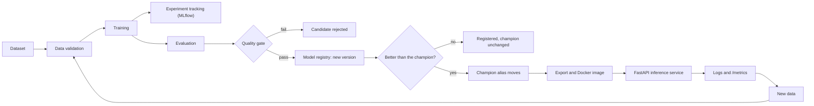

# Plant Disease Classification, with an ML mini-platform around it

[](https://github.com/Ennui-s/PlantDisease/actions/workflows/ci.yml)

A plant disease classifier (MobileNetV2 transfer learning, 15 classes of pepper, potato and tomato leaves, **95.18% test accuracy**) and the engineering system built around it: data validation, reproducible training, experiment tracking, evaluation with a quality gate, a model registry, a containerised inference API, monitoring, tests with CI, and a retraining workflow that replaces the live model only when a new one is significantly better.

The project has two layers, kept separate on purpose:

- **The workload:** the existing classifier. Its model, preprocessing and training logic are unchanged.
- **The platform:** everything that manages that model through its lifecycle. It does not replace the classifier.



Everything is deliberately simple and local: SQLite for MLflow, one container, in-process metrics. Anything that has not been run is marked **`[CONFIRM]`** in the docs and listed under [Status](#status-and-known-gaps); results quoted here are the numbers the runs produced.

## What exists and how to see it work

| Lifecycle stage | Where | See it work | Evidence so far |
|---|---|---|---|
| Data validation | `validation/` | `python -m validation.validate_data --stage all --verbose` | run on the real dataset: found 5 identical images leaking between train and val/test |
| Reproducible training | `training/`, `configs/` | `python -m training.train --config configs/smoke_test.yaml` | 1-epoch run completed through the new entry point |
| Experiment tracking | `tracking/` | `mlflow ui --backend-store-uri sqlite:///mlflow.db` | runs, parameters, metrics and artifacts visible in the UI |
| Evaluation and quality gate | `evaluation/` | `python -m evaluation.evaluate --model <checkpoint>` | reference reproduces 0.9518; the 1-epoch model (0.906) is rejected |
| Model registry | `registry/` | `python -m registry show`, `python -m registry check` | original model is version 1 and champion; loaded through the alias |
| Inference API | `serving/` | `uvicorn serving.app:app --port 8000` | predictions served; error cases covered by tests |
| Docker | `Dockerfile` | `docker build -t plant-disease-api .` | built and served a prediction without changes |
| Monitoring | `serving/monitoring.py` | `python -m serving.metrics_summary` | worked against the running container |
| Tests and CI | `tests/`, `.github/workflows/` | `python -m pytest -q` | 69 tests pass locally; GitHub Actions passes both jobs (lint and tests, Docker build and smoke test) |
| Retraining and promotion | `retraining/` | `python -m retraining` | decision logic unit-tested; real end-to-end run not done yet |

## Quick start

With Docker (the image carries its own copy of the champion model):

```bash
git clone https://github.com/Ennui-s/PlantDisease
cd PlantDisease
docker build -t plant-disease-api .
docker run --rm -p 8000:8000 plant-disease-api
curl -F "file=@leaf.jpg" http://localhost:8000/predict       # on Windows PowerShell use curl.exe
```

`GET /ready`, `GET /model` (which model version is served), `GET /metrics` and the interactive `/docs` are also available. To work with the platform itself (training, evaluation, registry, retraining), see [Getting started](#getting-started) below and the [demonstration walkthrough](docs/demo.md).

## Documentation

| Document | What it covers |
|---|---|
| [docs/architecture.md](docs/architecture.md) | lifecycle and component diagrams, what each stage guarantees, data and model flow |
| [docs/model_card.md](docs/model_card.md) | the model, its data, per-class results, intended use and limitations |
| [docs/failure_analysis.md](docs/failure_analysis.md) | where the model fails, data problems, failures met while building, remaining risks |
| [docs/engineering_decisions.md](docs/engineering_decisions.md) | the main decisions, with reasons and costs |
| [docs/demo.md](docs/demo.md) | a 10-minute walkthrough with the commands and real outputs |
| [docs/platform_reference.md](docs/platform_reference.md) | detailed documentation of every platform stage (what, why, how to run, how it was checked) |

---

# The existing classifier

## Problem

Farmers cannot physically inspect every crop, especially across large or dispersed fields. Manual inspection is slow, labour-intensive and infrequent, so early signs of disease can go unnoticed until intervention is less effective. The FAO estimates that up to 40% of global crop production is lost each year to pests and plant diseases ([FAO](https://www.fao.org/one-health/highlights/how-plant-diseases-threaten-global-food-security/en)).

## Objective

Classify plant leaf images into their crop and disease/healthy category using a CNN trained with transfer learning. The longer-term motivation is automated inspection (for example from field cameras) that flags diseased plants while they are still treatable. That deployment is not part of this repository.

## Dataset

[PlantVillage (Kaggle)](https://www.kaggle.com/datasets/emmarex/plantdisease/data): labelled leaf images captured under controlled conditions.

The model is trained on **15 classes** across three crops:

| Crop | Classes |
|---|---|
| Pepper (bell) | Bacterial spot, Healthy |
| Potato | Early blight, Late blight, Healthy |
| Tomato | Bacterial spot, Early blight, Late blight, Leaf mold, Septoria leaf spot, Spider mites (two-spotted), Target spot, Yellowleaf curl virus, Mosaic virus, Healthy |

- **Layout:** `dataset/raw/` holds one folder of images per class (for example `Potato___healthy`). Class labels are taken from the folder names.
- **Split:** 70% train / 20% validation / 10% test, applied **per class** by `data/split_dataset.py` (images are shuffled with `random.seed(42)`, then copied into `dataset/train`, `dataset/val` and `dataset/test`).
- **Preprocessing:** images are resized to 224 x 224 and converted to tensors. No normalisation and no data augmentation are applied.
- **Image counts:** 14,441 train / 4,125 validation / 2,073 test files (20,639 total). One of these is an extensionless file that the data loader skips, so the loaders see 20,638 images (see [data validation results](docs/platform_reference.md#data-validation-results-on-the-plantvillage-data)).

## Model

| Component | Detail |
|---|---|
| Framework | PyTorch / torchvision |
| Backbone | MobileNetV2 with ImageNet pretrained weights (`IMAGENET1K_V1`), **frozen** (`freeze_backbone = True`) |
| Head | Dropout (0.3) -> Linear (backbone output features -> 15 classes); softmax is applied to the logits at prediction time |
| Loss | Cross-entropy |
| Optimiser | Adam, learning rate 0.001, batch size 32 |
| Training control | Up to 12 epochs; early stopping on validation loss (patience 3); best model by validation accuracy saved to `best_model.pth` |
| Monitoring | TensorBoard (train loss, validation loss, validation accuracy per epoch) |

Only the classifier head is trained. MobileNetV2 was chosen for its balance of efficiency and accuracy.

```
Input (224x224 RGB) -> MobileNetV2 feature extractor (frozen)
  -> Dropout (0.3) -> Linear -> class scores -> softmax -> predicted class
```

### Hyperparameter tuning

Tuning was done by hand, judged on validation accuracy and loss curves in TensorBoard:

- Baseline: learning rate 0.003, batch size 64, frozen backbone. Validation accuracy plateaued early with minor instability.
- Learning rate reduced to 0.001, giving smoother convergence.
- Batch size reduced to 32.
- Partial unfreezing of the backbone was explored during tuning. The final configuration keeps the backbone frozen.
- Early stopping patience was adjusted so training stopped once validation performance stabilised.

Final values (all in `config.py`):

| Setting | Value |
|---|---|
| Learning rate | 0.001 |
| Batch size | 32 |
| Max epochs | 12 |
| Early stopping patience | 3 |
| Dropout | 0.3 |
| Optimiser | Adam |
| Image size | 224 |
| `freeze_backbone` | `True` |

## Evaluation

| Metric | Value |
|---|---|
| Test accuracy | 0.9517607332368548 |
| Validation accuracy | roughly 95-96% (stabilised) |

Evaluation artifacts produced by `training/evaluate.py`:

- **Confusion matrix** (`confusion_matrix.png`): most mass lies on the diagonal. The off-diagonal errors are mostly between similar tomato conditions (for example early blight, late blight, Septoria leaf spot and target spot).
- **Grad-CAM** (`gradcam_<n>.png`): heatmaps overlaid on the leaf image, showing which regions influenced the predicted class, labelled with the predicted class and its confidence. Grad-CAM targets the last convolutional layer of the network. In the examples reviewed during development, the model attended to diseased areas rather than the background.
- **TensorBoard logs**: training and validation curves.

Precision, recall, F1 and per-class metrics are not currently reported.

## Limitations

- Covers only three crops (pepper, potato, tomato) and 15 classes; other crops require further data and training.
- PlantVillage images are taken under controlled conditions. Variation in lighting, occlusion and background is not well represented, so field performance is likely lower than the test accuracy suggests.
- Fine-grained symptoms such as spider mites need high-resolution input to be visible.
- Leaf images say little about root vegetables, whose condition cannot be assessed from leaves alone.

## Repository structure

```
config.py              # central configuration: paths and hyperparameters (classifier defaults)
configs/
  training.yaml        # run configuration: overrides, seed, data validation thresholds
  smoke_test.yaml      # 1-epoch run that writes to separate model/log paths
  quality_gate.yaml    # quality gate margins and where the reference metrics live
  promotion.yaml       # when a retrained candidate may replace the champion
  reference_metrics.json  # generated once from the original model; commit it
  experiments/         # baseline, lr_0005, batch_64: experiment configs that extend training.yaml
requirements.txt
best_model.pth         # checkpoint of the best model from training
dataset/               # not in the repo; raw/ holds the images, train/val/test are generated
data/
  split_dataset.py     # per-class train/val/test split
  dataloader.py        # ImageFolder datasets, resize + ToTensor, DataLoaders
models/
  model.py             # PlantDiseaseModel (MobileNetV2 + new classifier head)
evaluation/
  evaluate.py          # evaluate a checkpoint on the test split, apply the quality gate
  metrics.py           # accuracy, precision, recall, F1, per-class metrics, confusion matrix
  gate.py              # quality gate
docs/                    # model card, failure analysis, architecture, decisions, demo, platform reference
tests/                   # pytest suite (unit, API and integration tests)
pytest.ini, ruff.toml, requirements-test.txt   # test and lint configuration
.github/workflows/ci.yml # GitHub Actions: lint, tests, Docker build and smoke test
Dockerfile               # inference image (CPU-only torch, bundled champion model)
requirements-serve.txt   # dependencies of the inference image
.dockerignore            # allow-list of what goes into the image
model_export/            # exported champion model baked into the image (python -m registry export); commit it
serving/
  app.py               # FastAPI app: /health, /ready, /model, /predict, /reload
  service.py           # the prediction logic (framework-free)
  images.py            # upload validation and preprocessing
  model_store.py       # loads the champion through the registry alias
  monitoring.py        # structured request logs and Prometheus-format metrics
  metrics_summary.py   # readable summary of /metrics
  settings.py          # environment-variable settings
  errors.py            # API error type
  check_parity.py      # checks serving preprocessing against the training transform
retraining/
  cli.py               # python -m retraining
  pipeline.py          # the workflow steps and the decision flow
  compare.py           # paired comparison with the champion, promotion rules
  new_data.py          # ingest and validate a batch of new images
  real_ops.py          # the real training / evaluation / registry steps
registry/
  cli.py               # python -m registry register | promote | show | check
  ops.py               # register, promote, list, load the champion (MLflow)
  policy.py            # rules: what may be registered or promoted, version metadata
  pyfunc_model.py      # the classifier packaged as an MLflow model
tracking/
  tracker.py           # MLflow wrapper (no-op when tracking is disabled)
training/
  train.py             # training entry point (original loop + validation gate + tracking + run summary)
  prepare.py           # loads run config, applies it, runs the data validation gate
  run_config.py        # YAML run config loader
  evaluate.py          # original evaluation script (confusion matrix, Grad-CAM); unchanged
utils/
  early_stopping.py    # early stopping
  checkpoint.py        # checkpoint saving
  visualization.py     # confusion matrix and Grad-CAM helpers
validation/
  checks.py            # data validation checks
  validate_data.py     # validation CLI and report
outputs/               # generated evaluation figures
reports/               # generated: data_validation.json, training_run.json, evaluation/<model>/
checkpoints/           # generated: per-experiment model checkpoints (not best_model.pth)
datasets/              # generated: derived datasets for retraining runs with new data
mlflow.db, mlruns/     # generated: MLflow tracking database and artifacts
logs/tensorboard/      # not in the repo; written during training
```

`dataset/`, `logs/` and `outputs/` are listed in `.gitignore`, so the dataset, TensorBoard logs and generated figures are not distributed with the repository.

## Getting started

Developed on Python 3.13 (VS Code). Training takes about 1 hour on an Nvidia GPU using 4 cores.

```bash
# 1. Install dependencies (torch, torchvision, tensorboard, numpy, matplotlib,
#    scikit-learn, Pillow, opencv-python-headless, pyyaml, mlflow, fastapi, uvicorn, python-multipart)
pip install -r requirements.txt

# 2. Put the dataset class folders in dataset/raw/

# 3. Create the train/val/test split
#    Delete any existing train/, val/ and test/ folders inside dataset/ first.
#    Skip this step to reuse the previous split.
python -m data.split_dataset

# 4. Train (validates the splits first; aborts if validation fails)
python -m training.train

# 5. Evaluate (confusion matrix, Grad-CAM)
python -m training.evaluate

# 6. View training curves
tensorboard --logdir logs/tensorboard
```

Training and evaluation use a CUDA GPU automatically when `torch.cuda.is_available()` is true, otherwise the CPU. The default `pip install torch` build on Windows is typically CPU-only; for GPU training install the CUDA build of torch from [pytorch.org](https://pytorch.org/get-started/locally/) before the other requirements.

All hyperparameters are set in `config.py`, except the number of samples Grad-CAM uses, which is set in `training/evaluate.py` (line 37).

The dataset is not included; download it from the Kaggle link above. The original exploratory notebook was run on Google Colab with data and outputs stored on Google Drive.

## Status and known gaps

**Verified on the real setup:** the data validation run, the 1-epoch training run through the new entry point, MLflow tracking, the reference evaluation (which reproduced the originally recorded accuracy exactly), the quality gate rejecting the 1-epoch model, registration and loading through the `champion` alias, the API, the Docker image, monitoring against the running container, the local test suite (69 tests), and the GitHub Actions workflow (lint, tests, and a Docker build and smoke test all pass).

**Not yet verified (marked `[CONFIRM]` in [docs/platform_reference.md](docs/platform_reference.md)):**
- comparing the `baseline`, `lr_0005` and `batch_64` experiment runs in the MLflow UI;
- `python -m serving.check_parity` on dataset images (the automated parity test passes), and `/reload` after a real promotion;
- the real retraining workflow end to end (`python -m retraining`), including a promotion decision.

**Known limitations** (details in [docs/failure_analysis.md](docs/failure_analysis.md)): all training photographs are controlled-condition leaf images; the model always answers with one of its 15 classes and its confidence is not calibrated; 5 identical images are shared between train and val/test (known and bounded) and near-duplicates were not checked; the same test set is used for evaluation, the gate and promotion decisions; metrics live in process memory; the API has no authentication; the registry is a local SQLite file.
