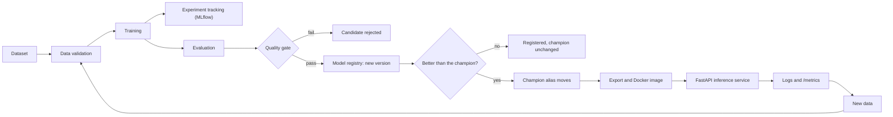
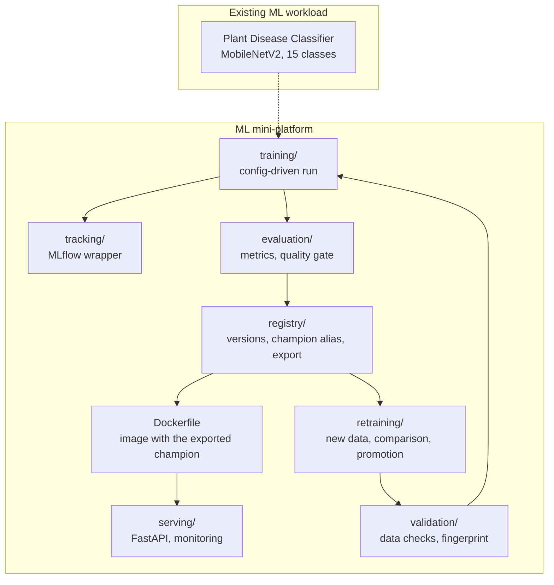

# Architecture

The project has two layers that are deliberately kept apart:

- **The workload:** the existing Plant Disease Classifier (MobileNetV2 transfer learning, 15 classes). Its model, preprocessing and training logic are unchanged.
- **The platform:** everything that manages the model through its lifecycle. None of it replaces the classifier; it validates its data, runs its training, judges its versions, serves it and watches it.

## Lifecycle

The loop at the bottom is the retraining path: new labelled images re-enter at data validation (`python -m retraining`).

## Components

| Stage | Where | What it guarantees |
|---|---|---|
| Data validation | `validation/` | training does not blindly consume arbitrary data: unreadable files, bad formats, unknown classes, duplicates, label conflicts and train/test leakage are detected; each dataset gets a fingerprint |
| Reproducible training | `training/`, `configs/` | the original training loop runs from a config file, gated by validation, with every run recorded |
| Experiment tracking | `tracking/`, MLflow | parameters, data fingerprint, code version, metrics and artifacts of every run, so runs can be compared |
| Evaluation and gate | `evaluation/` | the same metrics for every version; a candidate may not be worse than the reference beyond noise-based margins |
| Registry | `registry/` | each accepted model is a version with its lineage; the `champion` alias says which one is live |
| Serving | `serving/` | the service asks for "the champion" and reports which version answered; errors are controlled and carry no internals |
| Docker | `Dockerfile`, `model_export/` | `clone, build, run` with no database, volume or secret |
| Monitoring | `serving/monitoring.py` | structured logs without images, and metrics for traffic, rejections, errors, latency, confidence and class mix |
| Retraining | `retraining/` | a new version replaces the champion only if it is significantly better on the same test images and no class gets much worse |

## Data and model flow

1. `dataset/raw` is split once into `dataset/train|val|test`. New images only ever join `train`, so the test set never changes and all versions are comparable.
2. Training writes a checkpoint (`checkpoints/<name>.pth`) and an MLflow run.
3. Evaluation writes `reports/evaluation/<name>/` (metrics, per-image predictions, confusion matrix, Grad-CAM, gate result).
4. Registration packages the weights, class names, model code and signature as an MLflow model and records the evaluation as version tags.
5. `python -m registry export` copies the champion to `model_export/`; the Docker image bakes that folder in. The image therefore does not depend on the local registry database, whose artifact paths are specific to one machine.
6. The service loads the model, preprocesses uploads exactly as in training (resize to 224 x 224, scale to [0, 1], no normalisation), and reports the model version with every answer.

## Boundaries

- The classifier's code (`models/`, `data/`, `utils/`, the original `training/evaluate.py`) is not modified. The platform changes its configuration through a shared settings dictionary, and wraps its training loop in a function.
- Everything is local and simple on purpose: SQLite for MLflow, one container, in-process metrics. There is no orchestration platform, cloud deployment, authentication or alerting.
